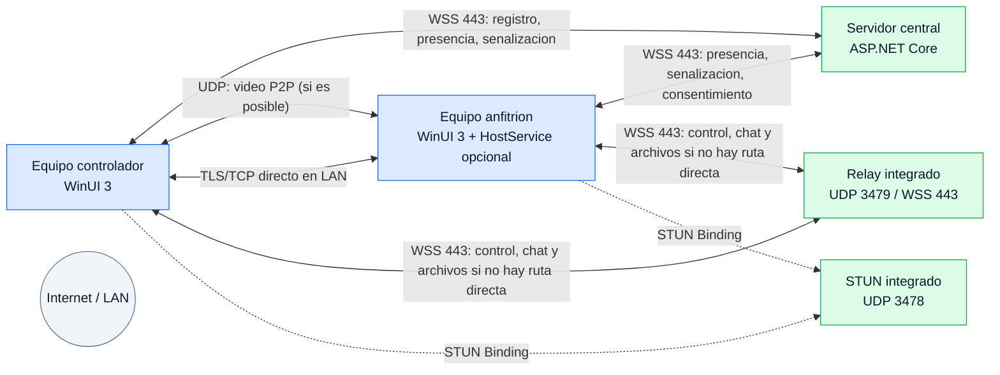
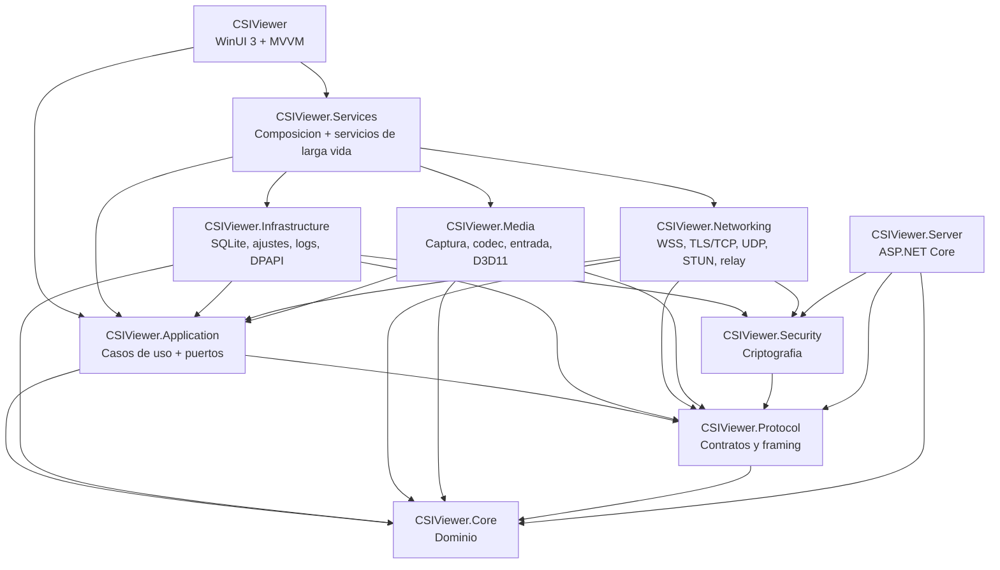
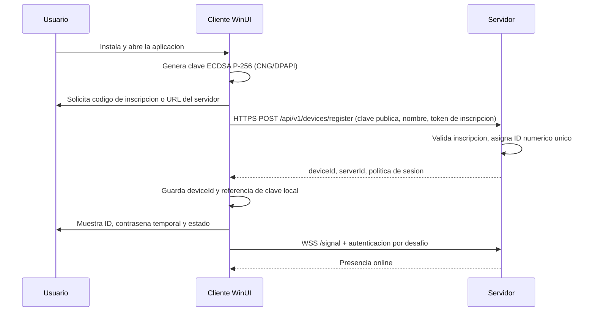

# Arquitectura de CSIViewer

Version: 1.0 (Fase 1)
Fecha: 2026-11-12
Estado: propuesta para aprobacion

---

## 1. Objetivo y alcance

CSIViewer es una aplicacion nativa de Windows para asistencia remota y control de escritorio. El diseno persigue cinco propiedades:

1. **Funcionalidad real**: captura, codificacion, transporte, decodificacion, entrada, chat y transferencia de archivos implementados de extremo a extremo, no solo interfaces.
2. **Seguridad por defecto**: consentimiento explicito, cifrado de extremo a extremo, identidad criptografica de dispositivo, validacion estricta y minima exposicion de datos.
3. **Estabilidad**: timeouts, cancelacion, reconexion, backoff, recuperacion de transferencias y aislamiento de fallos por sesion.
4. **Mantenibilidad**: capas con dependencias unidireccionales, puertos y adaptadores, pruebas automatizadas y protocolo versionado.
5. **Experiencia Windows 11**: WinUI 3 autentica, Mica, temas en caliente, navegacion fluida y accesibilidad.

### Fuera de alcance de la version 1

- Cliente macOS, Linux, iOS, Android o navegador web.
- Audio remoto, impresion remota, portapapeles bidireccional avanzado y transferencia de portapapeles de archivos.
- Acceso desatendido permanente. La version 1 exige consentimiento visible por sesion. Una modalidad desatendida, si se aprueba, sera una opcion explicita, visible y revocable.
- Captura de la pantalla segura de UAC y envio de Ctrl+Alt+Del sin privilegios especiales (ver [limites de Windows](06-riesgos-limites.md)).
- Alta disponibilidad multiservidor. El servidor se disena para un nodo con abstracciones que permitan escalar despues.

---

## 2. Atributos de calidad y metas

| Atributo | Meta verificable |
| --- | --- |
| Latencia de video | <= 150 ms de cristal a cristal en LAN; <= 300 ms en Internet moderado, con 30 FPS y 720p-1080p |
| Uso de CPU | Captura y codificacion por GPU cuando exista MFT hardware; < 10% de CPU en un equipo moderno a 1080p30 |
| Memoria | Sin crecimiento sostenido en sesiones de 8 horas; buffers acotados y reutilizados |
| Ancho de banda | Adaptativo entre 500 kbps y 20 Mbps; el usuario puede fijar limite |
| Disponibilidad | Una sesion o transferencia no bloquea la UI ni otras sesiones |
| Recuperacion | Reconexion automatica con backoff; transferencias reanudables desde el ultimo bloque confirmado |
| Seguridad | TLS 1.2+ en servidor, E2E AES-256-GCM, PBKDF2-SHA256, claves privadas no exportables o protegidas con DPAPI |
| Privacidad | El servidor no puede descifrar video, entrada, chat ni archivos; solo ve metadatos de sesion |
| Accesibilidad | Navegacion completa por teclado, nombres de automatizacion, alto contraste y escalado DPI |

Las metas se validaran con el banco de pruebas de la Fase 13. No se consideran garantias hasta medirlas en hardware real.

---

## 3. Vista de contexto



### Fronteras de confianza

1. **Cliente**: proceso de usuario. Guarda identidad, historial y ajustes. La UI nunca recibe datos de red sin pasar por Application.
2. **Servidor**: terminacion TLS, autenticacion de dispositivos, presencia, senalizacion, relay opaco y auditoria. No posee claves de sesion.
3. **Sesion E2E**: claves efimeras ECDH autenticadas con las claves de identidad de los dispositivos. El servidor y el relay solo ven ciphertext.
4. **HostService opcional**: servicio LOCAL SYSTEM para inyectar entrada en ventanas elevadas y enviar SAS. Solo se anade si se aprueba; tiene IPC restringido y no inicia sesiones por si mismo.

---

## 4. Estilo arquitectonico

Se adopta un **monolito modular con arquitectura hexagonal (puertos y adaptadores)** y direccion de dependencias hacia el dominio/aplicacion:



### Reglas de dependencia

- `Core` no depende de ningun otro proyecto.
- `Protocol` solo depende de `Core`.
- `Security` solo depende de `Core` y, si hace falta, de `Protocol` para envelopes.
- `Application` depende de `Core` y `Protocol`. Define los puertos que implementan las capas externas.
- `Networking`, `Media` e `Infrastructure` dependen de `Application` (para implementar sus puertos) y de las librerias de bajo nivel que necesiten.
- `Services` es la raiz de composicion del cliente. Es el unico proyecto que conoce todas las implementaciones.
- `UI` depende de `Application`, `Services` y `Core`. **No referencia `Networking`, `Media` ni `Infrastructure` directamente.**
- `Server` es independiente del cliente. No reutiliza `Infrastructure` ni `Services`; tiene su propia persistencia y composicion.
- `HostService` es un ejecutable aislado; no referencia `UI` ni `Services`.

Estas reglas se pueden comprobar con pruebas de arquitectura (por ejemplo, verificando referencias de ensamblado) en la Fase 13.

---

## 5. Componentes y responsabilidades

### 5.1 CSIViewer.Core

Modelo de dominio sin dependencias de UI, red o sistema operativo:

- `DeviceId`, `DeviceIdentity`, `SessionId`, `SessionPermissions`.
- `ConnectionSession`, `ConnectionResult`, `DisconnectReason`.
- `KnownDevice`, `DeviceGroup`, `Contact`.
- `ChatMessage`, `ChatThread`.
- `TransferJob`, `TransferState`, `FileManifest`, `TransferChunk`.
- `ErrorCode`, `AppError`, `Result<T>`.
- Maquinas de estado puras y validaciones de dominio.
- `TimeProvider` se inyecta; el dominio no usa `DateTime.UtcNow` directamente.

### 5.2 CSIViewer.Protocol

Contrato de comunicacion versionado:

- Envelope de senalizacion JSON.
- Mensajes de control, chat y transferencia.
- Framing binario de canales fiables.
- Cabecera de datagramas de video y entrada.
- Serializacion con `System.Text.Json` (source generation) y `BinaryPrimitives`.
- Validacion de tamanos, versiones, campos obligatorios y enumeraciones.
- Constantes de protocolo y negociacion de capacidades.

El detalle esta en [03-protocolo-seguridad.md](03-protocolo-seguridad.md).

### 5.3 CSIViewer.Security

- Identidad de dispositivo: ECDSA P-256, firma de desafios y de claves efimeras.
- Intercambio de claves: ECDH P-256 + HKDF-SHA256.
- Cifrado simetrico: AES-256-GCM con nonce por secuencia y ventana anti-replay.
- Hash de contrasenas: PBKDF2-SHA256, sal aleatoria, iteraciones configurables y comparacion en tiempo constante.
- Tokens de acceso y tickets de sesion: generacion con `RandomNumberGenerator`, almacenamiento solo del hash.
- Proteccion local: DPAPI (`ProtectedData`) y, cuando sea viable, claves CNG no exportables.
- Utilidades de borrado seguro de buffers y redaccion de secretos.

No se implementa criptografia propia de primitivas. Se usan exclusivamente primitivas de `System.Security.Cryptography` y se encapsulan para poder auditarlas y sustituirlas.

### 5.4 CSIViewer.Application

Casos de uso y puertos:

- `IDeviceIdentityService`, `IDeviceDirectory`, `IPresenceService`.
- `IConnectionCoordinator`, `ISessionManager`, `IConsentService`.
- `IScreenCapture`, `IVideoEncoder`, `IVideoDecoder`, `IInputInjector`, `IMonitorService`.
- `ITransportFactory`, `ISignalingClient`, `IMediaChannel`, `IReliableChannel`.
- `IPasswordHasher`, `ISessionCrypto`, `ITokenStore`.
- `IDeviceRepository`, `IContactRepository`, `IHistoryRepository`, `IChatRepository`, `ITransferRepository`.
- `ISettingsStore`, `IThemeService`, `ILocalizationService`, `IDialogService`, `INavigationService`.
- Orquestadores: `HomeService`, `ConnectService`, `RemoteSessionService`, `ChatService`, `FileTransferService`, `DeviceCatalogService`, `HistoryService`.
- Maquinas de estado de conexion y transferencia, reintentos, timeouts y mapeo de errores.

`Application` no conoce WinUI, sockets, SQLite ni Media Foundation. Solo contratos y logica.

### 5.5 CSIViewer.Networking

Adaptadores de red:

- `WebSocketSignalingClient`: WSS con TLS, autenticacion, reconexion y backoff.
- `TlsReliableChannel`: `SslStream` sobre TCP para rutas directas en LAN o con puerto accesible.
- `RelayReliableChannel`: WebSocket binario contra el servidor, con cola acotada.
- `UdpDataChannel`: datagramas UDP con AES-GCM, secuencia, ventana anti-replay, fragmentacion de video y canal fiable ligero para control/chat.
- `StunClient`: Binding Request/Response RFC 5389, candidatos reflexivos.
- `NatTraversalService`: recogida de candidatos, intercambio, connectivity checks y eleccion de ruta.
- `ConnectionRace`: intenta directa y relay en paralelo con timeouts, elige la primera ruta valida y cancela la perdedora.
- `ReconnectPolicy`: backoff exponencial con jitter, limites y condiciones de parada.
- `RateLimiter` de red y control de flujo.

Los sockets se crean por sesion, se cancelan con `CancellationToken` y se liberan con `IAsyncDisposable`. No hay sockets estaticos compartidos.

### 5.6 CSIViewer.Media

Adaptadores especificos de Windows:

- `WindowsGraphicsCaptureService`: `GraphicsCaptureItem`, `Direct3D11CaptureFramePool`, `GraphicsCaptureSession`, seleccion de monitor y manejo de cierre de sesion de captura.
- `MediaFoundationH264Encoder`: MFT de codificacion, configuracion CBR/low-latency, superficies D3D11, extraccion de NAL units.
- `MediaFoundationH264Decoder`: MFT de decodificacion, texturas NV12, fallback software.
- `D3D11VideoRenderer`: swap chain en `SwapChainPanel`, shader NV12/YUV a RGB, presentacion de baja latencia.
- `SendInputInjector`: raton absoluto sobre el escritorio virtual, botones, rueda, teclado por scancode y Unicode.
- `MonitorService`: enumeracion de monitores, DPI, rotacion y conversion de coordenadas.
- `CursorService`: posicion y forma del cursor si se opta por no incrustarlo en el video.
- `CaptureWatchdog`: reinicio de captura ante monitor desconectado, bloqueo o fallo del frame pool.

La captura y la codificacion se ejecutan fuera del hilo de UI. El renderizado se sincroniza con el hilo de UI solo para el swap chain.

### 5.7 CSIViewer.Infrastructure

- `SqliteClientDatabase` + repositorios EF Core para dispositivos, contactos, historial, chat y diario de transferencias.
- `JsonSettingsStore` atomico y versionado en la carpeta `data\` junto al ejecutable del cliente.
- `JsonLinesFileLoggerProvider` con rotacion, retencion y redaccion.
- `DpapiKeyStore` / `CngKeyStore` para identidad y secretos locales.
- `FileSystemService` para carpetas de descarga, espacio libre, nombres conflictivos y apertura de ubicaciones.
- `AppNotificationService` para notificaciones de Windows.
- `SingleInstanceService` y `StartupService`.
- `DiagnosticsService` para exportar logs y datos del sistema.
- `LocalDataProtector` para cifrar cuerpos de chat y notas sensibles.

### 5.8 CSIViewer.Services

Raiz de composicion del cliente y servicios de proceso:

- Registro de todas las dependencias en `Microsoft.Extensions.DependencyInjection`.
- `HostSessionService`: mantiene el estado de sesiones entrantes y salientes.
- `PresenceHeartbeatService`: mantiene la conexion de senalizacion.
- `TransferQueueService`: cola global, concurrencia y limites.
- `TrayIconService` y `SessionIndicatorService`: icono de bandeja e indicador visible de sesion activa.
- `AppLifecycleService`: arranque, cierre ordenado, cancelacion de tareas y liberacion de recursos.
- `UpdateService` (Fase 14).

### 5.9 CSIViewer

- Aplicacion WinUI 3, ventana principal, `NavigationView`, barra de titulo personalizada.
- Paginas: Inicio, Control remoto, Dispositivos, Transferencia de archivos, Chat, Historial, Contactos, Configuracion, Acerca de.
- ViewModels con CommunityToolkit.Mvvm, comandos asincronos y estados de carga/error.
- `NavigationService`, `DialogService`, `ThemeService`, `DispatcherService`.
- Recursos: `ResourceDictionary`, `ThemeDictionaries`, tokens semanticos, iconos Segoe Fluent Icons, tipografia y espaciado.
- Mica con fallback a Acrylic o color solido; `ExtendsContentIntoTitleBar`.
- Accesibilidad: `AutomationProperties`, orden de tabulacion, alto contraste y escalado.

### 5.10 CSIViewer.Server

ASP.NET Core 10, Kestrel, minimal APIs y WebSockets:

- Registro de dispositivos con token de inscripcion.
- Autenticacion por desafio ECDSA.
- Presencia en memoria y ultima conexion persistida.
- Senalizacion entre dispositivos.
- Registro de sesiones y aplicacion de reglas de unicidad.
- Relay opaco de control, chat y archivos; relay UDP de video.
- STUN integrado.
- Auditoria y limites de tasa.
- Persistencia EF Core SQLite (SQL Server opcional en el futuro).
- Servicio de Windows y endpoint de salud.

### 5.11 CSIViewer.HostService (opcional, Fase 8/14)

Servicio LOCAL SYSTEM para:

- Inyeccion de entrada en ventanas elevadas (UIPI).
- Envio de SAS (Ctrl+Alt+Del) si la directiva `SoftwareSASGeneration` lo permite.
- No captura la pantalla segura de UAC, porque Windows no lo permite con `Windows.Graphics.Capture`.

Se activa solo si el usuario lo instala y lo autoriza. El servicio no inicia sesiones ni acepta entrada sin un ticket de sesion emitido por la UI tras el consentimiento. Su IPC es un named pipe con ACL restringida al usuario interactivo y SYSTEM.

---

## 6. Flujos principales

### 6.1 Primer arranque y registro



El ID numerico es un identificador de enrutamiento, no un secreto. La identidad real es la clave publica registrada. La contrasena temporal se genera localmente y nunca se envia al servidor.

### 6.2 Conexion saliente con consentimiento

```mermaid
sequenceDiagram
    participant A as Controlador
    participant S as Servidor
    participant H as Anfitrion

    A->>S: connect_request(targetId, permisos, clave efimera A)
    S->>S: Valida presencia, limites y sesion unica
    S->>H: connect_request (identidad A, permisos solicitados)
    H->>H: Muestra dialogo de consentimiento
    H-->>S: connect_pending (clave efimera H, identidad H, salt)
    S-->>A: connect_pending
    A->>A: Verifica firma de H y deriva claves E2E
    A->>H: Prueba de contrasena cifrada E2E + nonce
    H->>H: Verifica PBKDF2 y decide
    H-->>S: connect_response (aceptar/rechazar, permisos finales)
    S-->>A: connect_response + ticket de sesion
    A->>S: candidates / relay_allocate
    S-->>H: candidates
    A<->H: Connectivity checks UDP / TLS directo
    A->>H: session_ready (canal fiable)
    H-->>A: video, cursor, estado
    A->>H: entrada, chat, archivos
    Note over H: Indicador visible de sesion activa y boton Finalizar
```

La contrasena temporal se verifica en el anfitrion. El servidor no la conoce ni puede usarla para iniciar una sesion.

### 6.3 Planos de datos

> **Estado de la build actual:** la conexión directa implementada es **TCP/TLS en LAN** con fallback al relay WSS. El canal UDP P2P, el hole punching y el relay UDP descritos en este documento son el objetivo de la siguiente fase y aún no están implementados.

| Plano | Transporte preferido | Fallback | Garantia |
| --- | --- | --- | --- |
| Senalizacion | WSS 443 | Ninguno; sin servidor no hay conexion | Fiable, ordenado, TLS |
| Video | UDP directo con AEAD | WSS 443 con cola acotada y descarte | No fiable, baja latencia |
| Entrada, chat, control | TCP/TLS directo en LAN (implementado); UDP P2P con canal fiable (objetivo) | WSS 443 relay | Fiable y ordenado |
| Archivos | TLS/TCP directo si hay ruta | WSS 443 relay | Fiable, por bloques, reanudable |

**Decision importante:** el video no viaja por un canal fiable. Un frame perdido se descarta y se solicita un keyframe si hace falta; no se bloquea la cabeza de cola. La entrada y el chat si requieren fiabilidad. Cuando el hole punching UDP funciona, el mismo socket transporta un **canal de control fiable ligero** (secuencia, ACK, retransmision, orden y ventana de 64 mensajes) ademas del video. Asi el control tambien es directo. Si el P2P UDP falla, el control cae a TLS/TCP en LAN o a WSS relay; el usuario ve la ruta real en la UI.

Si el servidor cae, una sesion directa ya establecida puede continuar porque su plano de datos no pasa por el servidor; las sesiones relayadas se interrumpen. No se pueden crear sesiones nuevas ni renovar tickets hasta que el servidor vuelva. Los clientes reintentan con backoff y la UI lo indica.

La capa `ITransportFactory` permite incorporar QUIC o WebRTC en el futuro sin cambiar `Application`, pero no se usan en la version 1 por las razones documentadas en el ADR-004.

### 6.4 Sesion entrante, permisos y revocacion

1. El anfitrion recibe `connect_request` y muestra: identidad del controlador, nombre, ID, permisos solicitados, tiempo restante y botones **Aceptar** / **Rechazar**.
2. Si el usuario acepta, se habilitan solo los permisos concedidos. Ver pantalla y controlar entrada son permisos independientes; transferir archivos y chat tambien.
3. Mientras la sesion esta activa:
   - La ventana muestra un banner persistente con el estado y un boton **Finalizar sesion**.
   - El icono de bandeja cambia y muestra acciones rapidas.
   - Un atajo global configurable (por ejemplo, `Ctrl+Alt+Shift+F12`) finaliza la sesion.
   - Un panel de sesion permite revocar permisos en caliente.
4. **Revocar todo** cierra todas las sesiones, invalida tickets y regenera la contrasena temporal.
5. Al finalizar, el servidor registra el resultado y el cliente libera captura, codec, sockets y buffers.

No existe un modo de acceso silencioso. La unica forma de iniciar una sesion es una accion visible del usuario del anfitrion, salvo una futura modalidad desatendida que, si se implementa, sera explicita, configurable y revocable.

### 6.5 Chat sin sesion de control

El chat puede funcionar como sesion de solo chat:

- Se reutiliza la senalizacion y el canal fiable.
- No se solicita permiso de captura ni de entrada.
- El historial se guarda localmente, cifrado en reposo.
- Si el otro equipo esta offline, la version 1 informa de ello; el almacenamiento y reenvio offline se evalua en la Fase 9 y no se promete.

### 6.6 Transferencia de archivos

1. El emisor envia un manifiesto: nombre, tamano, SHA-256 esperado, modo (archivo/carpeta), rutas relativas y politica de conflicto.
2. El receptor valida rutas, espacio libre, permisos y nombres; solicita confirmacion si hay conflicto.
3. Se transfiere por bloques de 1 MiB sobre el canal fiable, con ACK y ventana.
4. El receptor escribe en un archivo temporal, actualiza un diario en SQLite y calcula SHA-256 de forma incremental.
5. Al completar, verifica el hash, hace un rename atomico y notifica.
6. Si se interrumpe, al reanudar se consulta el diario, se valida el tamano y el hash parcial y se continua desde el ultimo bloque confirmado.
7. Nunca se ejecuta un archivo recibido. No se permite abrir automaticamente el archivo; solo se ofrece **Abrir ubicacion**.

Detalle en [03-protocolo-seguridad.md](03-protocolo-seguridad.md).

---

## 7. Estrategia de conectividad y NAT

### 7.1 Candidatos

Cada cliente publica, a traves de la senalizacion:

- Direccion LAN y puerto TCP de control (si esta disponible).
- Direccion LAN y puerto UDP de medios.
- Direccion reflexiva obtenida de STUN para UDP.
- Soporte de relay.

### 7.2 Intento de ruta

1. **LAN directa**: el controlador intenta TLS/TCP contra la direccion LAN del anfitrion. Si funciona, control, chat y archivos van directos y el video puede ir por UDP LAN.
2. **P2P UDP**: ambos extremos envian Binding Requests al candidato reflexivo del otro (hole punching) y realizan connectivity checks. Si se establece, el video y el canal de control/chat van directos por el mismo socket UDP; los archivos usan TCP directo si existe o relay.
3. **Relay**: si falla la ruta directa en un plazo configurable (por defecto 5 s), se usa el relay del servidor. El video puede usar relay UDP o WSS; el control, el chat y los archivos, WSS.
4. La ruta elegida se muestra en la UI: **LAN directa**, **P2P UDP (video + control)**, **Relay UDP** o **Relay WSS**.

### 7.3 Por que no WebRTC ni QUIC en la version 1

- **WebRTC** no tiene una implementacion gestionada oficial en la pila Microsoft. Usar libwebrtc o SIPSorcery rompe el requisito de tecnologias Microsoft y anade una dependencia nativa grande.
- **System.Net.Quic** en .NET 10 no expone datagramas QUIC. Los streams QUIC son fiables y reintroducen bloqueo de cabeza de cola para video; abrir un stream por frame es ineficiente.
- **SignalR** anade un protocolo y reconexion propios que no necesitamos; WebSocket nativo da control total, menor sobrecarga y un contrato documentado.
- **STUN/TURN**: se implementa un STUN minimo y un relay propio autenticado. No se implementa TURN completo porque no hay WebRTC y el relay se integra con la sesion, el control de cuotas y el cifrado E2E.

La decision se revisa en la Fase 13 con mediciones reales. Si la latencia del relay es insuficiente, se evalua un canal de control fiable sobre UDP o MsQuic via P/Invoke.

---

## 8. Maquinas de estado

### 8.1 Conexion

```text
Idle
  -> ResolvingPresence
  -> Signaling
  -> AwaitingConsent
  -> Authenticating
  -> NegotiatingTransport
  -> Connected
  -> Reconnecting -> Connected
  -> Closing
  -> Closed

Cualquier estado -> Failed (con ErrorCode)
AwaitingConsent -> Rejected
Authenticating -> Denied / RateLimited
NegotiatingTransport -> RelayFallback / Failed
```

Reglas:

- Las transiciones invalidas se rechazan y se registran.
- Cada sesion tiene `SessionId` y `Epoch`; los mensajes de una epoca anterior se descartan.
- Un solo controlador activo por anfitrion por defecto. Una segunda solicitud se rechaza con `HostBusy` o se encola si el usuario lo permite.
- El cierre es idempotente y siempre libera recursos.

### 8.2 Transferencia

```text
Queued -> Preparing -> Transferring -> Verifying -> Completed
                    -> Paused -> Transferring
                    -> Cancelled
                    -> Failed (reintentable o no)
```

Cada transicion se persiste en el diario antes de continuar, para sobrevivir a un cierre inesperado.

---

## 9. Persistencia

### 9.1 Cliente

- **SQLite** en `data\client.db` (junto al ejecutable del cliente) mediante EF Core 10.
- **Ajustes** en `data\settings.json`, escritura atomica y version de esquema.
- **Identidad** en el almacen de claves de Windows (CNG) o PKCS#8 protegido con DPAPI; nunca en texto plano.
- **Logs** en `data\logs\` en JSON Lines, con rotacion por tamano y retencion.
- **Diario de transferencias** en SQLite, con ruta temporal, bytes confirmados, hash parcial y estado.

Tablas principales: `KnownDevices`, `DeviceGroups`, `Contacts`, `ContactDevices`, `ConnectionHistory`, `ChatThreads`, `ChatMessages`, `TransferJournal`, `AuditEvents`, `SchemaVersion`.

Los cuerpos de chat y las notas privadas se cifran con una clave local protegida por DPAPI. Los metadatos necesarios para la UI (fechas, IDs, estados) se guardan en claro para permitir busquedas y filtros.

### 9.2 Servidor

- **SQLite** por defecto en `%PROGRAMDATA%\CSIViewer\server.db` (o ruta configurable), WAL y timeout de bloqueo.
- **SQL Server** opcional mediante proveedor EF Core y cadena de conexion; no se incluye en la version 1 salvo que se apruebe.
- Presencia en memoria con `ConcurrentDictionary`; la ultima conexion se persiste.
- Tablas: `Devices`, `EnrollmentTokens`, `Sessions`, `AuditEvents`, `SchemaVersion`.
- Migraciones EF Core al arrancar, con backup previo y validacion de version.
- Los payloads de relay no se almacenan. Los logs no contienen secretos ni contenido de chat.

### 9.3 Retencion

- Historial de conexiones: configurable (por defecto 12 meses).
- Logs: 14 dias o 100 MB, configurable.
- Mensajes de chat: locales hasta que el usuario los borre.
- Auditoria del servidor: configurable; por defecto 90 dias.

---

## 10. Modelo de concurrencia y rendimiento

- **Hilo de UI**: solo WinUI. Ninguna operacion de red, disco o codec se ejecuta en el.
- **Captura**: `Direct3D11CaptureFramePool.CreateFreeThreaded` para no depender del DispatcherQueue.
- **Codificacion/decodificacion**: hilos dedicados o pool con MFT asincrono; afinidad al dispositivo D3D11.
- **Red**: un bucle de lectura y otro de escritura por canal; `Channel<T>` acotado; sin `lock` alrededor de `await`.
- **Colas de video**: capacidad maxima de 2-3 frames o 100 ms; si se llena, se descarta el frame mas antiguo. Nunca se acumula latencia.
- **Buffers**: `ArrayPool<byte>` y superficies D3D11 reutilizadas; se devuelven en `finally`.
- **Backpressure**: el canal fiable aplica ventana y creditos; el emisor espera, no bloquea el hilo.
- **Cancelacion**: cada sesion, transferencia y operacion de red tiene un `CancellationTokenSource` enlazado.
- **Timeouts**: handshake 10 s, consentimiento 60 s, conectividad 5 s, inactividad de video 5 s, inactividad de archivo 30 s.
- **UI**: actualizaciones de estadisticas a 1 Hz como maximo; `x:Bind` compilado; listas virtualizadas; busqueda con debounce.
- **Cierre**: se detiene captura, se vacian canales, se cierran sockets, se liberan MFT y swap chain, y se espera a las tareas con timeout.

---

## 11. Errores, diagnostico y observabilidad

### 11.1 Taxonomia

`ErrorCode` incluye, como minimo:

- Red: `NetworkUnavailable`, `ServerUnreachable`, `Timeout`, `TlsFailure`, `RelayUnavailable`, `NatTraversalFailed`.
- Autenticacion: `InvalidCredentials`, `RateLimited`, `SessionExpired`, `DeviceRevoked`, `IdentityMismatch`.
- Sesion: `HostOffline`, `HostBusy`, `ConsentDenied`, `ConsentTimeout`, `SessionClosed`, `DuplicateSession`.
- Medios: `CaptureUnavailable`, `CaptureLost`, `EncoderUnavailable`, `DecoderFailure`, `RenderFailure`.
- Archivos: `DiskFull`, `PermissionDenied`, `IntegrityFailure`, `PathRejected`, `Conflict`, `TransferInterrupted`.
- Entrada: `InputBlockedByUipi`, `InputInjectionFailed`.

La UI muestra un mensaje localizado, accionable y un `CorrelationId`. Los detalles tecnicos van al log. Nunca se muestra un stack trace al usuario final.

### 11.2 Logs

- `Microsoft.Extensions.Logging` con un proveedor JSONL propio.
- Campos: timestamp UTC, nivel, categoria, eventId, correlationId, sessionId (sin secretos), dispositivo, duracion, errorCode.
- Redaccion de contrasenas, tokens, claves, contenido de chat y rutas completas cuando proceda.
- Escritura asincrona con cola acotada; si el disco falla, se degrada a Debug sin bloquear la app.
- Rotacion y retencion; exportacion a ZIP desde **Configuracion > Diagnostico**.

### 11.3 Salud y diagnostico

- Estado de senalizacion, NAT, ruta elegida, RTT, perdida, jitter, bitrate, FPS, frames descartados, codec y uso de GPU.
- Prueba de conectividad al servidor y a STUN desde la UI.
- Exportacion de diagnostico con version, OS, hardware, configuracion redactada y logs.
- Endpoint `/health` en el servidor y metricas basicas protegidas para administracion.

---

## 12. Despliegue

### 12.1 Cliente

- **Desarrollo**: aplicacion sin empaquetar (`WindowsPackageType=None`) para iterar rapido.
- **Produccion**: MSIX firmado, con identidad de paquete, tarea de inicio y notificaciones.
- Dependencias: Windows App SDK autosuficiente o framework-dependent; se decide en Fase 14.
- Arquitecturas: x64 y arm64. Sin x86 en la version 1.
- Firma de codigo EV para evitar advertencias de SmartScreen.
- Actualizaciones: MSIX App Installer o actualizador propio firmado; se decide en Fase 14.

### 12.2 Servidor

- ASP.NET Core publicado self-contained para win-x64.
- Ejecutable como servicio de Windows (`Microsoft.Extensions.Hosting.WindowsServices`).
- Kestrel con HTTPS y certificado; se puede poner detras de IIS o un proxy inverso con soporte WebSocket.
- Puertos:
  - 443/TCP: HTTPS y WSS.
  - 3478/UDP: STUN integrado.
  - 3479/UDP: relay de video.
  - 80/TCP opcional: redireccion a HTTPS.
- Firewall y certificados documentados en el manual de despliegue (Fase 14).
- Configuracion por `appsettings.json`, variables de entorno y secretos del sistema; nunca secretos en el repositorio.
- Un solo nodo en la version 1. Presencia en memoria; cuello de botella principal: ancho de banda del relay. Se documentan limites y se disena `IPresenceStore` para un backplane futuro.

### 12.3 Red

- La conexion directa requiere que el firewall permita el trafico entrante en los puertos efimeros del cliente o que exista una regla. Si no, se usa relay.
- El relay WSS funciona a traves de proxies que permitan WebSocket sobre 443.
- UDP puede estar bloqueado en redes corporativas; el video cae a WSS.
- IPv6 se soporta si el sistema y la red lo permiten; no se garantiza en la version 1.

---

## 13. Estrategia de pruebas

| Nivel | Herramienta | Cobertura |
| --- | --- | --- |
| Unidad | MSTest 4 | Criptografia, protocolo, validacion, maquinas de estado, backoff, rutas, ajustes, rate limit |
| Integracion | MSTest + ASP.NET Core TestServer | Registro, auth, presencia, senalizacion, sesion, relay, dos clientes, duplicados, reconexion |
| Archivos | MSTest + SQLite temporal | Transferencias grandes, carpetas, reanudacion, hash, conflictos, disco lleno simulado |
| Medios | MSTest + hardware real | Captura, encode/decode roundtrip, DPI, multi-monitor, inyeccion de entrada en ventana de prueba |
| Caos | TestHarness | Perdida de paquetes, latencia, corte de red, caida del servidor, cierre del peer |
| UI | Pruebas de ViewModel + lista manual | Navegacion, temas, persistencia, accesibilidad; la automatizacion UI completa se evalua en Fase 13 |

No se considera terminada una funcionalidad si solo tiene UI. Cada fase incluye pruebas y un criterio de aceptacion verificable.

---

## 14. Decisiones y documentos relacionados

- [Proyectos y dependencias](02-proyectos-dependencias.md)
- [Protocolo y seguridad](03-protocolo-seguridad.md)
- [Plan de implementacion](04-plan-implementacion.md)
- [ADR](05-adr.md)
- [Riesgos y limites de Windows](06-riesgos-limites.md)
- [Estado y preguntas abiertas](07-estado.md)
