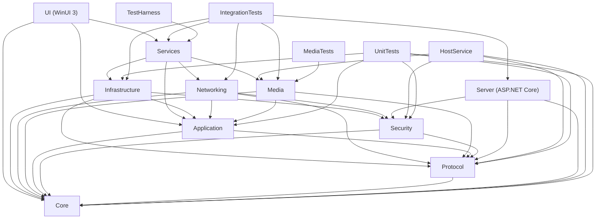

# Proyectos, dependencias y estructura de la solucion

Version: 1.0 (Fase 1)
Fecha: 2026-11-12

---

## 1. Resumen

La solucion se organiza en un **monolito modular** con proyectos separados por responsabilidad. No se crean microservicios: el servidor es un ejecutable independiente y el cliente es una aplicacion WinUI 3. Los proyectos de libreria permiten probar la logica sin arrancar la UI y evitan que la interfaz dependa de sockets, SQLite o Media Foundation.

La solucion se llamara `CSIViewer.slnx`. El nombre visible del producto es provisional y puede cambiarse sin afectar a los namespaces.

---

## 2. Proyectos

| Proyecto | Tipo | TFM | Responsabilidad | Depende de |
| --- | --- | --- | --- | --- |
| `CSIViewer.Core` | Class library | `net10.0` | Dominio, entidades, value objects, errores, maquinas de estado puras | Ninguno |
| `CSIViewer.Protocol` | Class library | `net10.0` | Mensajes, framing, serializacion, validacion, versionado | Core |
| `CSIViewer.Security` | Class library | `net10.0` | Identidad, ECDH/ECDSA, AES-GCM, HKDF, PBKDF2, tokens, anti-replay | Core, Protocol |
| `CSIViewer.Application` | Class library | `net10.0` | Casos de uso, puertos, orquestacion, servicios de aplicacion | Core, Protocol |
| `CSIViewer.Networking` | Class library | `net10.0` | WSS, TLS/TCP, UDP, STUN, NAT, relay, reconexion | Application, Core, Protocol, Security |
| `CSIViewer.Media` | Class library | `net10.0-windows10.0.19041.0` | Captura, Media Foundation, D3D11, entrada, monitores | Application, Core, Protocol |
| `CSIViewer.Infrastructure` | Class library | `net10.0-windows10.0.19041.0` | SQLite/EF Core, ajustes JSON, logs, DPAPI/CNG, archivos, notificaciones | Application, Core, Protocol, Security |
| `CSIViewer.Services` | Class library | `net10.0-windows10.0.19041.0` | Composicion DI, sesiones de proceso, bandeja, indicador, ciclo de vida | Application, Core, Protocol, Security, Networking, Media, Infrastructure |
| `CSIViewer` | WinUI 3 app | `net10.0-windows10.0.19041.0` | Vistas XAML, ViewModels, navegacion, temas, accesibilidad | Application, Core, Services |
| `CSIViewer.Server` | ASP.NET Core + WinUI 3 app | `net10.0-windows10.0.19041.0` | CSIViewer Servidor: registro, auth, presencia, senalizacion, relay, STUN, auditoria; interfaz de configuracion, bandeja y UPnP | Core, Protocol, Security |
| `CSIViewer.Host` | Windows Service | `net10.0-windows10.0.19041.0` | CSIViewer Host: arranque desatendido y lanzamiento del cliente en la sesion activa | Microsoft.Extensions.Hosting |
| `CSIViewer.HostService` | Windows Service | `net10.0-windows10.0.19041.0` | Entrada elevada y SAS opcional (Fase 8/14) | Core, Protocol, Security, Media |
| `CSIViewer.UnitTests` | MSTest | `net10.0` | Pruebas unitarias | Core, Protocol, Security, Application, Infrastructure |
| `CSIViewer.IntegrationTests` | MSTest | `net10.0-windows10.0.19041.0` | Servidor + dos clientes, red, archivos, reconexion | Todos los anteriores salvo UI |
| `CSIViewer.MediaTests` | MSTest | `net10.0-windows10.0.19041.0` | Captura, codec, D3D11, entrada, DPI | Media, Core, Protocol |
| `CSIViewer.TestHarness` | Console app | `net10.0-windows10.0.19041.0` | Simulacion, caos, latencia, perdida, diagnostico | Services, Networking, Media |

### Por que se anaden `Media`, `HostService` y `TestHarness`

- **Media**: la captura, Media Foundation y D3D11 son la parte mas delicada y especifica de Windows. Aislarlos permite probarlos y sustituirlos sin tocar la logica de sesion.
- **HostService**: la inyeccion en ventanas elevadas y SAS no se puede hacer desde un proceso de usuario normal (UIPI). Es un componente opcional, separado y con privilegios minimos.
- **TestHarness**: permite reproducir perdida de paquetes, latencia, caidas y transferencias grandes sin depender de dos equipos fisicos.

No se anaden proyectos de "UI shared", "Common" o "Helpers" genericos: cada tipo vive en la capa que le corresponde. Evitamos carpetas basura y dependencias circulares.

---

## 3. Grafo de dependencias



### Reglas que se verificaran automaticamente

1. `Core` no referencia nada fuera de la BCL.
2. `UI` no referencia `Networking`, `Media`, `Infrastructure` ni `Server`.
3. `Application` no referencia `Infrastructure`, `Networking`, `Media`, `Services` ni `UI`.
4. `Server` no referencia `Infrastructure` ni `Services`.
5. Ningun proyecto de produccion referencia un proyecto de pruebas.
6. Ninguna dependencia apunta hacia arriba en el grafo.

Se implementara una prueba de arquitectura que inspeccione las referencias de ensamblado y falle si se rompe una regla.

---

## 4. Paquetes NuGet

Se usa **Central Package Management** (`Directory.Packages.props`) para fijar versiones en un unico lugar. Solo se declaran paquetes Microsoft o mantenidos por Microsoft; no se anaden ORMs, serializadores, loggers, frameworks de UI ni librerias nativas de terceros.

| Paquete | Version | Uso | Justificacion |
| --- | --- | --- | --- |
| `Microsoft.WindowsAppSDK` | `2.6.5` | WinUI 3, Mica, ciclo de vida, notificaciones | Plataforma oficial de UI moderna de Windows |
| `Microsoft.Windows.SDK.BuildTools` | `10.0.28000.2957` | Compilacion de recursos y proyecciones WinRT | Necesario para WinUI/MSIX |
| `CommunityToolkit.Mvvm` | `8.4.2` | `ObservableObject`, `RelayCommand`, source generators | Mantenido por Microsoft/.NET Foundation; reduce boilerplate MVVM |
| `Microsoft.Extensions.DependencyInjection` | `10.0.15` | Contenedor DI | Estandar Microsoft, sin reflexion pesada |
| `Microsoft.Extensions.Logging` | `10.0.15` | Abstraccion de logs | Estandar Microsoft |
| `Microsoft.Extensions.Logging.Console` | `10.0.15` | Log de consola en servidor y harness | Diagnostico |
| `Microsoft.Extensions.Hosting` | `10.0.15` | Host del servidor y servicios | Ciclo de vida y configuracion |
| `Microsoft.Extensions.Hosting.WindowsServices` | `10.0.15` | Servicio de Windows | Despliegue del servidor |
| `Microsoft.EntityFrameworkCore.Sqlite` | `10.0.15` | Persistencia cliente y servidor | Microsoft, migraciones, consultas LINQ |
| `Microsoft.EntityFrameworkCore.Design` | `10.0.15` | Migraciones en desarrollo | Solo herramienta de build |
| `System.Security.Cryptography.ProtectedData` | `10.0.15` | DPAPI | Proteccion de secretos locales en Windows |
| `Microsoft.Windows.CsWin32` | `0.3.371` | P/Invoke generado para Win32 | Menos errores que firmas manuales; generador Microsoft |
| `MSTest` | `4.5.3` | Pruebas | Framework de pruebas Microsoft |
| `Microsoft.NET.Test.Sdk` | `18.12.0` | Ejecucion de pruebas | Compatible con .NET 10 |
| `Microsoft.AspNetCore.Mvc.Testing` | `10.0.15` | Servidor en memoria para integracion | Microsoft |

### Paquetes que se evitan deliberadamente

- **WebRTC**: no hay implementacion gestionada oficial Microsoft.
- **FFmpeg / libav**: se usa Media Foundation.
- **Serilog / NLog**: se implementa un proveedor JSONL pequeno sobre `Microsoft.Extensions.Logging`.
- **Dapper / NHibernate**: EF Core es suficiente.
- **protobuf-net / MessagePack**: `System.Text.Json` + `BinaryPrimitives` cubren el protocolo.
- **Vortice.Windows / SharpDX**: la interop D3D11/MF se hace con interfaces COM minimas y CsWin32 donde aplique.
- **H.NotifyIcon**: el icono de bandeja se implementa con `Shell_NotifyIcon` y una ventana oculta Win32.
- **Hardcodet.NotifyIcon**: misma razon.

Si en una fase futura se demuestra que un paquete ahorra un riesgo tecnico real, se propone y se justifica antes de anadirlo.

---

## 5. Configuracion de compilacion

### `global.json`

Fija el SDK 10.0.404 y permite actualizaciones de feature band:

```json
{
  "sdk": {
    "version": "10.0.404",
    "rollForward": "latestFeature",
    "allowPrerelease": false
  }
}
```

### `Directory.Build.props`

Aplica a todos los proyectos:

- `LangVersion=latest`, `Nullable=enable`, `ImplicitUsings=enable`.
- Analizadores .NET activados y estilo aplicado en build.
- `Deterministic=true`, `DebugType=portable`.
- Globalizacion activada (la app esta localizada).
- Advertencias como errores solo en CI, para no bloquear la iteracion local.
- Sin `TargetFramework` global: cada proyecto declara el suyo.
- Sin `RuntimeIdentifier` global: se especifica al publicar.

### `Directory.Packages.props`

Centraliza versiones. Los proyectos usan `<PackageReference Include="..." />` sin `Version`.

### `Directory.Build.targets` (Fase 2, si hace falta)

Se usara solo para:

- Propiedades comunes de WinUI/MSIX.
- Copia de recursos y manifiestos.
- Validacion de arquitectura y de version del protocolo.

No se usara para ocultar logica de negocio ni para parchear proyectos.

---

## 6. Estructura de carpetas prevista

```text
CSIViewer.slnx
Directory.Build.props
Directory.Packages.props
global.json
.editorconfig
.gitignore
README.md

docs/
  01-arquitectura.md
  02-proyectos-dependencias.md
  03-protocolo-seguridad.md
  04-plan-implementacion.md
  05-adr.md
  06-riesgos-limites.md
  07-estado.md

src/
  CSIViewer.Core/
    Devices/
    Sessions/
    Chat/
    Transfers/
    Common/
  CSIViewer.Protocol/
    Signaling/
    Frames/
    Messages/
    Serialization/
  CSIViewer.Security/
    Identity/
    KeyExchange/
    Encryption/
    Passwords/
    Tokens/
  CSIViewer.Application/
    Abstractions/
    Sessions/
    Devices/
    Chat/
    Transfers/
    Settings/
    Common/
  CSIViewer.Networking/
    Signaling/
    Reliable/
    Media/
    Nat/
    Reconnect/
  CSIViewer.Media/
    Capture/
    Encoding/
    Decoding/
    Rendering/
    Input/
    Monitors/
    Interop/
  CSIViewer.Infrastructure/
    Persistence/
    Settings/
    Logging/
    Security/
    FileSystem/
    Notifications/
    Diagnostics/
  CSIViewer.Services/
    Composition/
    Hosting/
    Sessions/
    Tray/
    Lifecycle/
  CSIViewer/
    App.xaml
    MainWindow.xaml
    Views/
    ViewModels/
    Services/
    Controls/
    Themes/
    Assets/
    Strings/
  CSIViewer.Server/
    Api/
    Signaling/
    Relay/
    Stun/
    Devices/
    Sessions/
    Persistence/
    Security/
    Observability/
  CSIViewer.HostService/
    Ipc/
    Input/
    Hosting/

tests/
  CSIViewer.UnitTests/
  CSIViewer.IntegrationTests/
  CSIViewer.MediaTests/

tools/
  CSIViewer.TestHarness/
```

### Convenciones

- Namespaces = nombre del proyecto + carpeta.
- Archivos con `PascalCase`; un tipo publico por archivo salvo tipos pequenos relacionados.
- `Async` en metodos asincronos; `CancellationToken` como ultimo parametro.
- `IAsyncDisposable` para recursos con limpieza asincrona.
- Nombres de UI localizados con `x:Uid`; claves de recursos en ingles.
- Sin `async void` salvo event handlers de UI, que capturan y registran excepciones.
- Sin `Task.Run` para envolver IO; solo para trabajo CPU-bound.
- `ConfigureAwait(false)` en librerias; en UI se respeta el contexto cuando se actualiza estado.
- Fechas en UTC en dominio y persistencia; conversion a local solo en presentacion.
- IDs en `Guid` para entidades locales y `DeviceId`/`SessionId` como value objects.

---

## 7. Creacion de la solucion (Fase 2)

El entorno actual no tiene instalada una plantilla `dotnet new winui`. En la Fase 2 se creara el proyecto WinUI 3 con un `.csproj` SDK-style explicito para Windows App SDK 2.6.5 y se validara con un build real. No se asumira que una plantilla inexistente funciona.

Secuencia prevista:

1. Crear `CSIViewer.slnx`.
2. Crear las class libraries y el servidor con `dotnet new classlib` / `dotnet new web`.
3. Crear `CSIViewer` manualmente con `UseWinUI`, `WindowsPackageType`, manifiesto y `App.xaml`.
4. Anadir referencias segun el grafo.
5. Compilar en `Debug|x64` y ejecutar una ventana vacia con Mica y tema.
6. Anadir la prueba de arquitectura.

Criterio de salida de la Fase 2: la solucion compila, la app arranca, navega entre secciones y cambia de tema sin reiniciar.

---

## 8. Definition of Done por proyecto

Un proyecto se considera terminado cuando:

- Compila sin errores y sin advertencias nuevas en CI.
- Tiene pruebas para su logica critica.
- No expone secretos en logs ni en memoria mas tiempo del necesario.
- Maneja cancelacion y errores esperados.
- Tiene documentacion de sus puertos y dependencias.
- No rompe las reglas de dependencia.
- Se ha probado en x64; arm64 se valida en Fase 13/14.
