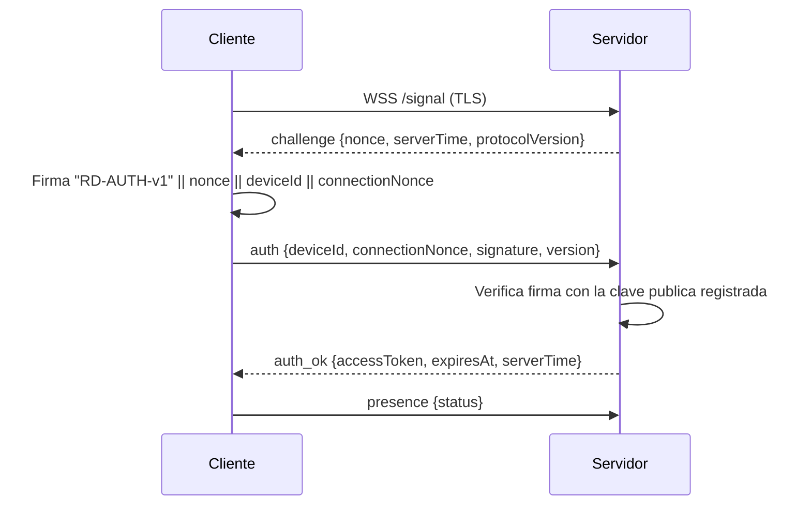

# Protocolo y modelo de seguridad

> **Estado de implementación:** el protocolo E2E, la señalización WSS, el relay WSS y el canal directo LAN por TCP están implementados. El canal fiable sobre UDP, el hole punching y el relay UDP de este documento son diseño objetivo para la fase P2P y todavía no están en la build.

Version: 1.0 (Fase 1)
Fecha: 2026-11-12
Estado: diseno para aprobacion; no implementado aun

---

## 1. Principios

1. **El servidor no es de confianza para el contenido.** La senalizacion pasa por el servidor, pero el video, la entrada, el chat y los archivos se cifran de extremo a extremo con claves que el servidor no posee.
2. **La identidad es una clave, no un numero.** El ID de 9 digitos sirve para enrutar; la autenticidad se basa en una clave ECDSA P-256 registrada.
3. **La contrasena temporal nunca viaja al servidor.** Se verifica en el anfitrion, dentro de un canal E2E.
4. **Todo mensaje se valida antes de procesarse.** Version, tipo, tamanos, campos, rutas y enumeraciones.
5. **Todo tiene timeout y cancelacion.** Ninguna espera es indefinida.
6. **Nada oculto.** No hay puertas traseras, acceso silencioso ni persistencia encubierta.

---

## 2. Modelo de amenazas

| Amenaza | Vector | Mitigacion | Riesgo residual |
| --- | --- | --- | --- |
| Escucha pasiva | WiFi, ISP, proxy | TLS 1.2+/1.3 en servidor; AES-256-GCM E2E | Ninguno practico si las claves no se filtran |
| MITM activo | Red o servidor malicioso | Firmas ECDSA del transcript; pinning de dispositivos conocidos | Primer contacto sin verificacion out-of-band (TOFU) |
| Servidor malicioso | Operador del servidor | E2E; no recibe contrasena ni claves; relay opaco | Ve metadatos, puede denegar servicio o suprimir mensajes |
| Peer malicioso | Controlador no autorizado | Consentimiento explicito, contrasena, permisos independientes, validacion | Ingenieria social |
| Fuerza bruta | Intentos de contrasena | 12 caracteres aleatorios (~59 bits), PBKDF2 600k, bloqueo exponencial, rate limit del servidor | Ataque online distribuido limitado por el servidor |
| Replay | Repeticion de paquetes | Nonces de handshake, contador AEAD, ventana anti-replay, IDs de mensaje | Ninguno practico |
| Inyeccion de datos | Paquetes malformados | Validacion estricta, limites de tamano, allowlist de tipos | Fallos de implementacion; se cubren con fuzzing |
| Path traversal | Nombres de archivo | Normalizacion, rechazo de rutas absolutas/`..`/ADS, comprobacion de prefijo | Enlaces/reparse points; se rechazan |
| Archivo malicioso | Archivo recibido | Nunca se ejecuta; hash; se muestra extension y tamano; no auto-open | El usuario puede ejecutarlo manualmente |
| DoS | Inundacion de conexiones o frames | Limites por IP/dispositivo, colas acotadas, timeouts, max frame, descarte de video | Ataque volumetrico a la red |
| Robo local | Malware o usuario local | DPAPI/CNG, ACL, logs redactados, bloqueo de pantalla | Malware con mismos privilegios |
| Captura no autorizada | Acceso oculto | Consentimiento visible, indicador persistente, boton finalizar, atajo global | Compromiso del proceso anfitrion |

### Fuera del modelo

- Un atacante con control total del kernel o del usuario interactivo puede leer la pantalla y las claves en uso. Ninguna aplicacion de usuario puede evitarlo.
- La pantalla segura de UAC y el escritorio de bloqueo no son capturables con `Windows.Graphics.Capture`.
- Un servidor malicioso puede hacer un ataque de disponibilidad o de metadatos. La confidencialidad e integridad del contenido siguen protegidas.

---

## 3. Identidad de dispositivo

### 3.1 Clave de identidad

- Algoritmo: ECDSA P-256 (`ECDsa.Create(ECCurve.NamedCurves.nistP256)`).
- Generacion en el primer arranque.
- Almacenamiento preferido: clave CNG no exportable (`CngKeyCreationParameters` con `ExportPolicy = None`) en el almacen del usuario.
- Alternativa: PKCS#8 cifrado con DPAPI (`ProtectedData.Protect` con ambito `CurrentUser`) y ACL restrictiva.
- La clave privada nunca sale del equipo, nunca se registra y nunca se envia.
- La clave publica se registra en el servidor.

### 3.2 ID de dispositivo

- Formato: 9 digitos decimales, mostrado como `123 456 789`.
- Generado por el servidor con `RandomNumberGenerator`, comprobando colision en la base de datos.
- No es un secreto. Se puede compartir para recibir asistencia.
- Un ID puede revocarse; el dispositivo debera inscribirse de nuevo.

### 3.3 Registro

1. El administrador genera un token de inscripcion de un solo uso (o habilita inscripcion abierta con rate limit, no recomendado).
2. El cliente envia por HTTPS: clave publica, nombre del equipo, plataforma, version y token de inscripcion.
3. El servidor valida el token, crea el dispositivo, asigna ID y devuelve la configuracion de sesion.
4. El servidor guarda solo la clave publica y el hash del token de inscripcion.
5. Si el cliente pierde la clave privada, debe revocarse el dispositivo y emitir una nueva inscripcion. No hay recuperacion silenciosa.

### 3.4 Pinning y cambio de clave

- Al conectar con un dispositivo conocido, el cliente compara la huella SHA-256 de la clave publica con la guardada.
- Si cambia, se bloquea la conexion y se muestra una advertencia; el usuario debe aceptar explicitamente el nuevo pin.
- La huella se muestra en la ficha del dispositivo y en el dialogo de consentimiento.
- Esto limita el dano de un servidor que intente sustituir claves.

---

## 4. Autenticacion con el servidor



- El desafio es un nonce aleatorio de 32 bytes, valido 30 segundos y de un solo uso.
- La firma usa ECDSA-SHA256.
- El token de acceso es aleatorio de 32 bytes; el servidor guarda `SHA-256(token)` y su caducidad (24 h por defecto).
- El token se renueva al reconectar. Nunca se registra.
- El canal WSS exige TLS valido y nombre de host correcto. No se desactiva la validacion de certificados.
- Para servidores autohospedados con CA privada, el cliente importa el certificado raiz o fija la huella del servidor durante la inscripcion. La fijacion se puede rotar con dos huellas simultaneas.

---

## 5. Handshake de sesion E2E

### 5.1 Objetivo

Derivar claves simetricas efimeras para una sesion, autenticando a ambos dispositivos con sus claves de identidad, sin que el servidor pueda leer ni modificar el contenido.

### 5.2 Flujo

```mermaid
sequenceDiagram
    participant A as Controlador A
    participant S as Servidor
    participant H as Anfitrion H

    A->>S: connect.request {sessionId, targetId, permissions, ephA, nonceA}
    S->>H: connect.request {A: deviceId, publicKey, fingerprint, permissions, ephA, nonceA}
    H->>H: Genera ephH, nonceH
    H-->>S: connect.pending {ephH, nonceH, salt, hostIdentity}
    S-->>A: connect.pending
    A->>A: Verifica pin de H; calcula Z y claves
    H->>H: Calcula Z y claves
    A->>H: auth.proof (AES-GCM K_c2h) {password, permissions}
    H->>H: Verifica PBKDF2 y limites
    H->>H: Muestra consentimiento al usuario
    H-->>A: auth.result (AES-GCM K_h2c) {accepted, grantedPermissions}
    H-->>S: connect.response {accepted, grantedPermissions}
    S->>S: Crea sesion y ticket
    S-->>A: connect.response {ticket, sessionId}
    A->>H: session.ready (firmado/MAC)
```

### 5.3 Derivacion de claves

Sea:

- `Z = ECDH(ephA_private, ephH_public)` (P-256).
- `transcript = SHA-256("RD-SESSION-v1" || sessionId || deviceIdA || deviceIdH || ephA || ephH || nonceA || nonceH || permissionsSolicitados)`.
- `PRK = HKDF-Extract(salt = transcript, ikm = Z)`.
- Claves de 32 bytes:
  - `K_confirm = HKDF-Expand(PRK, "rd/v1/confirm", 32)`
  - `K_c2h = HKDF-Expand(PRK, "rd/v1/control/a2h", 32)`
  - `K_h2c = HKDF-Expand(PRK, "rd/v1/control/h2a", 32)`
  - `K_media_c2h = HKDF-Expand(PRK, "rd/v1/media/a2h", 32)`
  - `K_media_h2c = HKDF-Expand(PRK, "rd/v1/media/h2a", 32)`

Cada direccion tiene su propia clave. No se reutiliza una clave para control y medios.

### 5.4 Autenticacion mutua

Cada parte firma con su clave de identidad:

```text
firma = ECDSA-SHA256(IK_private, "RD-SESSION-AUTH-v1" || transcript)
```

El controlador verifica la firma del anfitrion con la clave publica obtenida del servidor y comparada con el pin. El anfitrion verifica la firma del controlador con la clave publica registrada. Si cualquiera falla, se aborta antes de mostrar el consentimiento.

### 5.5 Prueba de contrasena

- El anfitrion genera una sal de 16 bytes por sesion.
- Mantiene en memoria `hash = PBKDF2-SHA256(passwordTemporal, sal, 600000, 32)`.
- El controlador envia la contrasena dentro de `auth.proof`, cifrada con `K_c2h` y un nonce nuevo.
- El anfitrion calcula PBKDF2 con la contrasena recibida y compara en tiempo constante (`CryptographicOperations.FixedTimeEquals`).
- Si falla: incrementa el contador, aplica bloqueo y devuelve un error generico. No se muestra el dialogo de consentimiento.
- Si acierta: borra el buffer de la contrasena, resetea el contador y muestra el consentimiento.
- La contrasena y el hash se borran de memoria al cerrar la sesion o regenerar la contrasena.

La contrasena temporal:

- 12 caracteres de un alfabeto sin ambiguedades (`23456789ABCDEFGHJKLMNPQRSTUVWXYZ`), generados con `RandomNumberGenerator`.
- Entropia aproximada: 12 * log2(32) = 60 bits.
- Se muestra agrupada: `ABCD-EFGH-JKLM`.
- Se regenera con un boton; la anterior deja de ser valida inmediatamente.
- Caduca configurablemente (por defecto 24 h o al cerrar la aplicacion, segun ajuste).
- Nunca se guarda en disco en texto plano.

### 5.6 Confirmacion

- `K_confirm` se usa para un MAC del transcript final y de las capacidades negociadas.
- Cualquier discrepancia aborta la sesion.
- El `sessionId` lo genera el servidor antes del handshake para poder correlacionar la sesion, pero las claves no dependen de que el servidor sea honesto: las firman ambos dispositivos.

---

## 6. Cifrado de datos

### 6.1 AES-256-GCM

- Clave de 32 bytes por direccion y plano.
- Nonce de 12 bytes: `salt(4) || counter(8)`. El salt se deriva de la sesion; el contador empieza en 0 y nunca se repite.
- AAD: cabecera completa del frame, `sessionId` y `epoch`.
- Tag: 16 bytes.
- Limite de mensajes por clave: 2^31. Al alcanzarlo, se renegocia la clave o se cierra la sesion.
- Se rechaza cualquier nonce repetido o anterior a la ventana.

### 6.2 Ventana anti-replay

- Ventana deslizante de 1024 paquetes por canal.
- Se descarta un paquete con secuencia ya vista o demasiado antigua.
- Los paquetes fuera de orden dentro de la ventana se aceptan para video; el canal fiable los reordena.
- Los mensajes de handshake llevan nonce y timestamp; se rechazan si el timestamp difiere mas de 60 s y el nonce ya se uso.

### 6.3 Rotacion

- Las claves son efimeras por sesion.
- Una reconexion abre una nueva sesion con nuevas claves.
- No se reutilizan claves entre sesiones.
- El servidor no puede forzar la reutilizacion sin romper las firmas.

---

## 7. Protocolo de senalizacion

### 7.1 Envelope

```json
{
  "v": 1,
  "type": "connect.request",
  "id": "550e8400-e29b-41d4-a716-446655440000",
  "ts": "2026-11-12T10:15:30.123Z",
  "sessionId": "fs2h7...",
  "payload": { }
}
```

- `v`: version del protocolo. Se rechaza una version mayor no soportada.
- `type`: allowlist de tipos.
- `id`: UUID para deduplicacion e idempotencia.
- `ts`: UTC ISO 8601; informativo y para limites.
- `sessionId`: opcional, obligatorio en mensajes de sesion.
- `payload`: objeto especifico; maximo 64 KiB.

Serializacion con `System.Text.Json` y `JsonSerializerContext` (source generation). Opciones: camelCase, enums como string, `UnmappedMemberHandling.Disallow` cuando sea posible, profundidad maxima 16, maximo de bytes antes de deserializar.

### 7.2 Mensajes del cliente al servidor

| Tipo | Campos principales | Respuesta |
| --- | --- | --- |
| `auth` | deviceId, connectionNonce, signature, version | `auth.ok` / `auth.error` |
| `presence.set` | status (`online`, `busy`, `invisible`) | `presence.ok` |
| `connect.request` | targetId, permissions, ephA, nonceA, clientInfo | `connect.pending` o error |
| `connect.cancel` | sessionId, reason | `connect.cancelled` |
| `connect.response` | sessionId, accepted, grantedPermissions, reason | `session.ready` |
| `candidate.add` | sessionId, candidateType, address, port, priority | `candidate.ok` |
| `relay.allocate` | sessionId, transport (`udp`, `wss`), requestedBps | `relay.ready` |
| `session.end` | sessionId, reason | `session.ended` |
| `ping` | nonce | `pong` |

### 7.3 Mensajes del servidor al cliente

| Tipo | Campos principales |
| --- | --- |
| `auth.challenge` | nonce, serverTime, protocolVersion |
| `auth.ok` | accessToken, expiresAt, serverTime |
| `presence.update` | deviceId, status, lastSeen |
| `connect.request` | sessionId, controller identity, permissions, ephA, nonceA, expiresAt |
| `connect.pending` | sessionId, ephH, nonceH, salt, hostIdentity |
| `connect.response` | sessionId, accepted, grantedPermissions, ticket |
| `candidate.add` | sessionId, candidate |
| `relay.ready` | sessionId, endpoint, token, expiresAt |
| `session.ended` | sessionId, reason, by |
| `error` | code, message, retryAfter, correlationId |
| `pong` | nonce |

### 7.4 Limites y validacion

- Maximo 64 KiB por mensaje de senalizacion.
- Maximo 256 conexiones WebSocket por IP (configurable).
- Maximo 1 conexion de senalizacion activa por dispositivo; la nueva cierra la anterior con `Replaced`.
- Rate limit: 30 mensajes/minuto por dispositivo para `connect.request`; 5 intentos de conexion fallidos por minuto.
- Timeout de autenticacion: 10 s.
- Timeout de inactividad: 60 s con ping/pong cada 20 s.
- Se rechazan mensajes con tipos desconocidos, campos obligatorios ausentes, enumeraciones invalidas o payload sobredimensionado.
- El servidor no registra el payload completo; solo metadatos y codigos de error.

---

## 8. Protocolo de datos

### 8.1 Canal fiable

Se usa TLS/TCP directo, WebSocket binario relayado o un canal fiable ligero sobre el mismo UDP del P2P. El framing logico es comun:

```text
+----------+---------+---------+----------+-------------------+----------+
| len u32  | type u8 | flags u8| seq u32  | payload (N bytes) | tag 16 B |
+----------+---------+---------+----------+-------------------+----------+
```

- `len` incluye type, flags, seq y payload, sin el prefijo ni el tag.
- Maximo 1 MiB por payload.
- `seq` es monotono por direccion; el receptor ordena y detecta duplicados.
- El payload va cifrado con AES-GCM; el AAD incluye la cabecera y el `sessionId`.
- El canal garantiza orden y entrega; si se rompe, la sesion pasa a `Reconnecting`.

Variante UDP fiable:

- La cabecera anade `ack u32`, `ackBits u32` y `receiveWindow u16`.
- Ventana maxima de 64 mensajes; ACK inmediato o piggyback cada 10 ms.
- Retransmision con RTO inicial de 100 ms, backoff x2, maximo 3 intentos; despues se declara la ruta perdida y se intenta relay.
- Los mensajes de control, botones y teclas son fiables. Los movimientos de raton pueden marcarse como descartables: si llega uno mas nuevo, el anterior se ignora.
- El receptor entrega en orden y descarta duplicados; el emisor no supera la ventana.
- Video y control comparten socket UDP, pero usan claves (`K_media_*` y `K_c*`) y contadores de nonce distintos.
- Si el canal UDP fiable no se establece, se usa TLS/TCP o WSS sin cambiar los mensajes de aplicacion.

Tipos:

| Tipo | Contenido |
| --- | --- |
| `session.hello` | version, capabilities, sessionId, epoch |
| `session.accept` | permisos finales, configuracion de video |
| `input.event` | evento binario de raton/teclado |
| `chat.message` | messageId, texto, timestamp |
| `chat.ack` | messageId |
| `file.offer` | manifiesto |
| `file.accept` | decision, politica de conflicto |
| `file.chunk` | transferId, fileIndex, offset, data |
| `file.ack` | transferId, fileIndex, offset confirmado |
| `file.complete` | transferId, fileIndex, sha256 |
| `file.verify` | resultado |
| `file.pause` / `file.resume` / `file.cancel` | transferId |
| `video.request_keyframe` | monitorId, reason |
| `video.config` | codec, width, height, fps, bitrate |
| `stats` | rtt, loss, fps, bitrate, frames dropped |
| `ping` / `pong` | nonce, timestamp |
| `session.bye` | reason |

### 8.2 Entrada

Los eventos de entrada usan un formato binario fijo para minimizar latencia y asignaciones:

```text
type u8, flags u8, monitorId u8, reserved u8,
x i32, y i32,            // coordenadas normalizadas 0..65535 o absolutas
button u8, wheel i16,    // rueda vertical
hwheel i16, keyCode u16, scanCode u16,
timestampUs u64
```

- Movimiento de raton: se envia a la frecuencia de captura del controlador, con coalescencia si hay exceso.
- Botones: down/up con flag; doble clic se compone de dos down/up.
- Arrastrar y soltar: secuencia down, moves, up; se garantiza que un `up` siempre se envia al finalizar o perder el foco.
- Teclado: `scanCode` para compatibilidad de distribucion; `keyCode` como respaldo; `KEYEVENTF_EXTENDEDKEY` cuando aplique.
- Texto compuesto/IME: eventos Unicode cuando el layout remoto no coincida.
- Al cerrar la sesion o perder el foco, se liberan todas las teclas y botones presionados para evitar estados atascados.

### 8.3 Video

Datagrama UDP:

```text
version u8, type u8, flags u8, headerLen u8,
sessionEpoch u32, frameId u32, seq u32,
timestampUs u64, fragmentIndex u16, fragmentCount u16,
payloadLen u16, monitorId u8, codec u8,
payload (<= 1120 bytes), tag (16 bytes)
```

- Tamano total maximo 1200 bytes para evitar fragmentacion IP.
- `flags`: keyframe, config, last-fragment.
- Un frame se divide en fragmentos; el receptor lo reensambla con timeout de 100 ms.
- Si falta un fragmento, se descarta el frame y se solicita un keyframe por el canal fiable.
- `video.config` informa de resolucion, codec, fps y bitrate; se reenvia al cambiar de monitor o resolucion.
- El cursor puede ir incrustado en el frame (mas simple) o separado (mas fluido). La version 1 incrusta el cursor y anade un overlay local si la latencia lo justifica; se decide con mediciones en Fase 7.
- No se retransmiten frames completos. La recuperacion es por keyframe.
- Se descarta el frame mas antiguo si la cola supera 100 ms.

### 8.4 Archivos

```text
file.offer:
  transferId, rootName, isFolder, totalSize, fileCount,
  conflictPolicy, files[] { relativePath, size, sha256 }

file.chunk:
  transferId, fileIndex, offset, length, data[<=1 MiB]

file.ack:
  transferId, fileIndex, nextOffset
```

- El receptor escribe en `<destino>\.rdpart\<transferId>\<fileIndex>.part`.
- Se calcula SHA-256 incremental con `IncrementalHash`.
- Al completar un archivo: verificar hash, cerrar, `File.Move` atomico al destino final.
- El diario SQLite guarda `transferId`, ruta relativa, offset confirmado, hash esperado y estado.
- Reanudacion: se valida que el archivo parcial tenga el tamano esperado y que el hash parcial coincida; si no, se reinicia ese archivo.
- Limite de velocidad con token bucket; pausa detiene la lectura; reanudar continua desde el offset confirmado.
- No se permiten rutas absolutas, `..`, unidades, flujos alternativos (`:`), nombres reservados (`CON`, `PRN`, etc.), puntos/espacios finales ni enlaces simbolicos/reparse points.
- Se comprueba espacio libre antes de aceptar y durante la transferencia.
- Nunca se ejecuta el archivo. La UI ofrece **Abrir ubicacion**, no **Abrir**.

---

## 9. Permisos y consentimiento

### 9.1 Permisos

| Permiso | Descripcion | Concesion |
| --- | --- | --- |
| `ViewScreen` | Ver la pantalla | Independiente |
| `ControlInput` | Mover raton y enviar teclado | Independiente; requiere `ViewScreen` |
| `Chat` | Enviar y recibir mensajes | Independiente |
| `FileSend` | Enviar archivos al anfitrion | Independiente |
| `FileReceive` | Recibir archivos del anfitrion | Independiente |
| `Clipboard` | Futuro; no incluido en v1 | N/A |

- El controlador solicita un subconjunto; el anfitrion concede el subconjunto que decida.
- Conceder `ControlInput` no concede `FileSend` ni `FileReceive`.
- Reducir permisos es inmediato. Aumentarlos requiere una nueva confirmacion del anfitrion.
- La UI del anfitrion muestra los permisos activos y permite revocarlos uno a uno.

### 9.2 Dialogo de consentimiento

Debe mostrar:

- Nombre e ID del controlador.
- Huella de la clave publica (abreviada) y si es un dispositivo conocido.
- Permisos solicitados, con explicacion.
- Duracion maxima de la sesion o "hasta finalizar".
- Botones **Aceptar**, **Rechazar** y **Ver detalles**.
- Temporizador de expiracion (60 s) y accion al expirar (rechazar).

No se puede aceptar desde una notificacion sin abrir la app. No hay aceptacion automatica en v1.

### 9.3 Indicador de sesion

- Banner persistente en la ventana principal.
- Icono de bandeja con estado y menu **Finalizar sesion**, **Revocar permisos**, **Abrir**.
- Atajo global configurable para finalizar.
- La sesion se cierra automaticamente si el usuario cierra sesion en Windows, bloquea el equipo (configurable) o pulsa **Revocar todo**.
- El controlador tambien ve un indicador de que el anfitrion puede finalizar en cualquier momento.

---

## 10. Gestion de secretos

| Secreto | En memoria | En disco | En logs |
| --- | --- | --- | --- |
| Clave privada de identidad | Solo al firmar; se libera | CNG/DPAPI | Nunca |
| Clave de sesion E2E | Solo durante la sesion | Nunca | Nunca |
| Contrasena temporal | Solo para mostrar/verificar | Nunca en claro | Nunca |
| Hash de contrasena temporal | Solo en memoria | Nunca | Nunca |
| Token de acceso | Solo durante la conexion | Nunca en claro | Nunca |
| Token de inscripcion | Solo al registrar | Solo hash en servidor | Nunca |
| Contenido de chat | UI y memoria | Cifrado con clave local | Nunca |
| Archivos | Buffers acotados | Temp + destino | Solo metadatos |

- Se usa `CryptographicOperations.ZeroMemory` para buffers sensibles.
- Las cadenas inmutables se evitan para secretos cuando sea posible; se usan `char[]`/`byte[]` y se borran.
- La UI enmascara la contrasena por defecto; el boton **Mostrar** es una accion explicita.
- El portapapeles no se usa para secretos salvo accion del usuario, y se ofrece limpiar tras un tiempo.

---

## 11. Proteccion contra fuerza bruta y abuso

### 11.1 Anfitrion

- 5 intentos fallidos por dispositivo controlador en 5 minutos.
- Bloqueo exponencial: 30 s, 1 min, 2 min, 5 min, 15 min.
- Maximo 20 intentos fallidos por hora; despues se bloquea hasta regenerar la contrasena.
- Cada intento fallido se registra con ID de controlador, hora y correlationId; nunca con la contrasena.
- Las solicitudes de conexion repetidas se limitan a 3 por minuto por controlador.
- El dialogo de consentimiento no se muestra si la contrasena es incorrecta.

### 11.2 Servidor

- Rate limit por IP y por dispositivo con ASP.NET Core RateLimiter.
- Limite de conexiones simultaneas.
- Limite de sesiones pendientes por dispositivo (1).
- Limite de ancho de banda de relay por sesion y por dispositivo.
- Timeout de autenticacion y de inactividad.
- Bloqueo temporal de IPs con fallos repetidos, con lista de allowlist para administracion.
- Respuestas de error genericas para no filtrar si un ID existe.

### 11.3 Backoff de reconexion

- 1 s, 2 s, 4 s, 8 s, 16 s, 30 s (maximo), con jitter de +/-20%.
- Se detiene tras 10 intentos o si el error es permanente (`DeviceRevoked`, `InvalidCredentials`, `ConsentDenied`).
- Se reinicia el contador tras 5 minutos de conexion estable.
- La UI muestra el siguiente intento y permite cancelar.

---

## 12. Auditoria

Se registran eventos sin contenido sensible:

- Registro de dispositivo, revocacion, cambio de clave.
- Autenticacion correcta/fallida, bloqueo por fuerza bruta.
- Solicitud de conexion, consentimiento, rechazo, expiracion.
- Inicio/fin de sesion, permisos concedidos/revocados, motivo de cierre.
- Transferencias: inicio, fin, cancelacion, error, hash verificado.
- Regeneracion de contrasena, revocacion de todas las sesiones.
- Cambios de configuracion de seguridad.

Campos: eventId, timestamp UTC, actorDeviceId, targetDeviceId, sessionId, category, severity, result, correlationId, metadata redactada.

El servidor guarda auditoria en SQLite; el cliente guarda eventos locales. La exportacion de diagnostico incluye logs, no secretos.

---

## 13. Seguridad del servidor

- TLS 1.2+ con preferencia 1.3; certificados validos; HSTS.
- Kestrel con limites de request body, timeouts y max connections.
- WebSocket: max message size, autenticacion antes de cualquier comando, timeout de handshake.
- Validacion de todos los payloads con source-generated JSON y limites.
- Sin CORS para la API nativa; sin endpoints anonimos salvo `/health` y registro con token.
- Rate limiting global y por dispositivo.
- Contraseñas de administracion (si se anaden) con PBKDF2 y bloqueo.
- Secretos de configuracion fuera del repositorio (variables de entorno, DPAPI, user secrets en desarrollo).
- Logs sin tokens, sin claves, sin contenido.
- Relay: solo reenvia frames ya cifrados; valida sesion, ticket, expiracion y cuotas; no inspecciona payload.
- Actualizaciones y backups documentados; base de datos con ACL restrictiva.
- Cabeceras de seguridad y proteccion contra clickjacking no aplican a API nativa, pero se configuran.

---

## 14. Seguridad del cliente

- Proceso de usuario, sin elevacion por defecto.
- `app.manifest` con `requestedExecutionLevel=asInvoker`, DPI awareness PerMonitorV2 y longPathAware.
- No se carga codigo remoto, no se ejecutan scripts y no se deserializa polimorficamente.
- Todas las rutas de archivo se validan y se confinan al directorio de destino.
- Los archivos recibidos no se abren ni se ejecutan automaticamente.
- La UI no muestra stack traces; muestra codigos y un ID de correlacion.
- El proceso se cierra de forma ordenada y libera captura, codec y sockets.
- Actualizaciones firmadas; no se aceptan actualizaciones sin firma valida.

---

## 15. Limitaciones y trabajo futuro

1. **Revision criptografica externa.** El handshake es un diseno propio (aunque use primitivas estandar). Antes de produccion se recomienda una revision independiente y vectores de prueba.
2. **Argon2id.** .NET no incluye Argon2id en la BCL. Se usa PBKDF2-SHA256 con 600k iteraciones, que cumple el requisito. Si se aprueba una dependencia gestionada auditada, se puede migrar con un identificador de algoritmo y rehash al iniciar sesion.
3. **TLS en conexiones directas.** Se usara TLS con certificado autofirmado y pinning de la clave del dispositivo; el E2E ya autentica el contenido. La implementacion exacta se valida en Fase 6.
4. **P2P fiable.** La version 1 incluye un canal fiable ligero sobre UDP para control y chat, con fallback a TLS/TCP o WSS. Los archivos usan TCP directo o relay WSS; un canal de archivos sobre UDP/QUIC se evalua en Fase 13 si las mediciones lo justifican.
5. **Metadatos.** El servidor ve quien conecta con quien, cuando y cuanto dura. No se promete anonimato.
6. **Pantalla segura.** UAC, Ctrl+Alt+Del y pantalla de bloqueo no se capturan ni se controlan sin componentes privilegiados y, en algunos casos, sin directivas del sistema.
7. **Servidor de un solo nodo.** La version 1 no ofrece alta disponibilidad; se documenta y se disena la abstraccion para escalar.
